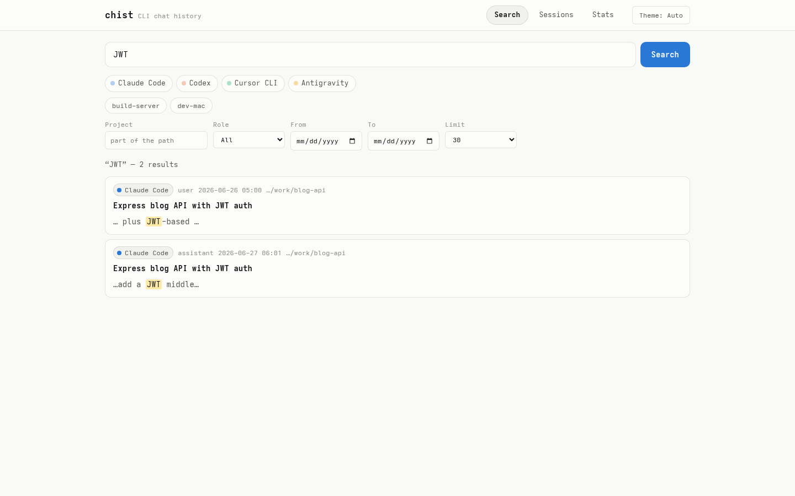

# chist — CLI チャット履歴の統合検索

English: [README.md](README.md)

Claude Code / Codex / Cursor CLI / Antigravity CLI のチャット履歴を 1 つの SQLite に集約し、
日本語で全文検索する。追加依存なし（Python 3.9 標準ライブラリのみ）。



確定スキーマは
[`db/schema.sql`](db/schema.sql)、MCP サーバの導入は [`docs/mcp-setup.md`](docs/mcp-setup.md)、
複数マシンの集約は [`docs/deploy.md`](docs/deploy.md) を参照。

## 使い方

```bash
python3 -m chist ingest              # 取り込み（2回目以降は差分のみ）
python3 -m chist search 'trigram'    # 全文検索
python3 -m chist sessions -c myapp   # セッション一覧（プロジェクト絞り込み）
python3 -m chist show <ext_id>       # 会話本文
python3 -m chist stats               # 統計
python3 -m chist errors              # パース失敗の一覧

python3 -m chist backfill            # host / project_key を埋める
python3 -m chist push http://…:8848  # 管理サーバへ差分送信（複数マシン集約時）
python3 -m chist prune --before 2026-01-01 --dry-run   # 削除（条件の指定が必須）

python3 -m chist reindex             # 検索用 DB を追いつかせる（持っている場合）
python3 -m chist reindex --check     # 正本と突き合わせる
python3 -m chist remask              # 集約サーバ用: いまの規則なら伏せる行の件数
```

DB は既定で `~/.local/share/chist/history.db`（`600`）。`--db` または環境変数
`CHIST_DB` で変更できる。

### 主なオプション

```
search  -s/--source  ソースを絞る（複数可）
        --host       マシン名で絞る（複数可）
        -c/--cwd     プロジェクトパスの部分一致
        -r/--role    user | assistant | system | tool
        --since / --until   ISO8601（例 2026-07-01）
        -n/--limit   既定 20
        --raw        シークレットをマスクしない
        -t/--target  search（検索用 DB）| record（正本の中の索引）。下の「検索用 DB」
show    --thinking   思考ブロックも表示
ingest  --limit N    処理ファイル数の上限（動作確認用）
prune   --before / --after  期間（ISO8601）
        -s/--source  ソース単位
        --session    セッション単位（ext_id または id）
        --match      本文の部分一致（誤取り込みの救済）
        --dry-run    件数だけ表示
        -y/--yes     確認を省略（非対話環境では必須）
        --vacuum     削除後にファイルサイズを詰める
reindex --check      突き合わせるだけ。食い違えば exit 1
        --rebuild    捨てて作り直す
        --compare Q  正本の索引と同じ行が返るか（複数可）
        --search-db  検索用 DB のパス（既定: CHIST_SEARCH_DB、無ければ正本の隣）
remask  -y/--yes     上書きして伏せる（既定は件数だけ。**戻せない**）
```

## 履歴の削除

取り込みは追記のみなので、放っておくと DB は増え続ける。実測では 1 件あたり
3.8〜5.9KB（FTS の trigram 索引が本文の約 1.9 倍を占める）で、日常利用なら年
150〜300MB 程度。容量より、**誤って取り込んだものや機微な会話を消す手段**として要る。

```bash
chist prune --before 2026-01-01 --dry-run     # まず件数を確認
chist prune --before 2026-01-01 --yes --vacuum
chist prune --match 'パスワード' --dry-run     # 誤取り込みの救済
chist prune --session <ext_id> --yes          # セッション単位
```

条件は AND で組み合わさる。**条件を 1 つも指定しないと何もしない**（全件削除の事故を
避けるため、全消しは用意していない。消すなら DB ファイルごと削除する）。

集約サーバ側は同じ CLI をコンテナ内で実行する。

```bash
docker exec chist-server python -m chist prune --before 2026-01-01 --dry-run
docker exec chist-server python -m chist prune --before 2026-01-01 --yes --vacuum
```

**注意点:**

- `ts` を持たないソース（Cursor CLI）も期間指定の対象になる。セッションの終了時刻で
  代替判定するため、取りこぼさない
- `--vacuum` を付けないとファイルサイズは縮まない（領域が再利用されるだけ）。
  VACUUM は DB を作り直すので、同サイズの空き容量が要る
- 本文が空になったセッションは併せて削除する（`--keep-sessions` で残せる）。
  削除対象に含まれなかった空セッションは巻き込まない
- **元のログファイルが残っていて `ingest_state` を消すと、再取り込みで復活する。**
  恒久的に消したい場合は元ファイルも削除する
- **MCP には削除ツールを用意していない。** 読み取り専用の宣言（`read_only_hint`）を
  崩さないため、また誤った削除は復旧できないため、削除は CLI に限定している

## 実測値（2026-07-31, macOS）

| 項目 | 値 |
|---|---|
| 取り込み元 | 1034 ファイル / 約 1.86GB |
| 所要時間（初回・全件） | **14.9 秒** |
| 2 回目（差分なし） | 0.1 秒未満 |
| DB サイズ | 130MB（FTS インデックス込み） |
| 検索応答 | 約 0.05 秒 |

| source | messages | sessions |
|---|---:|---:|
| claude-code | 49,263 | 769 |
| codex | 1,488 | 10 |
| cursor-cli | 410 | 9 |
| antigravity-cli | 225 | 3 |

同じプロジェクトを複数ツールで触った履歴が横断で引ける。例:
`/Users/you/Projects/example-app` は claude-code 9,372 / codex 297 /
antigravity-cli 51 メッセージ。

## 構成

```
chist/
  cli.py              コマンドライン
  ingest.py           差分取り込みドライバ
  search.py           検索（正本の中の索引）と、検索先の決定 resolve_target()
  searchdb.py         検索用 DB（search.db）: 写し・trigram・bigram、追随と作り直し
  prune.py            削除、remask（保存済みの行にいまのマスク規則を当てる）
  mask.py             出力時のシークレットマスキング
  db.py               接続・スキーマ適用
  adapters/
    base.py           JSONL 差分読み取り、Anthropic 形式 content の分解
    claude_code.py    ~/.claude/projects/**/*.jsonl
    codex.py          ~/.codex/sessions/**/*.jsonl
    cursor_cli.py     ~/.cursor/projects/*/agent-transcripts/*/*.jsonl
    antigravity_cli.py  ~/.gemini/antigravity-cli/conversations/*.db
  pb.py               protobuf wire format デコーダ（.proto 定義なしで読む）
  mcp_server.py       MCP サーバ（唯一の外部依存。他は依存ゼロを維持）
db/schema.sql
tools/antigravity_pbtext.py   protobuf 構造の調査に使ったプロトタイプ（参考）
tools/search_check.py         毎日の突き合わせ（Docker ホストのタイマーから。失敗時に Gotify）
```

## 仕様上の注意

**検索語の長さの扱いは、どちらの DB が答えるかで違う。**

```
検索用 DB（search）   3 文字以上 → trigram 索引 / **2 文字 → bigram 索引** / 1 文字 → 外す
正本の索引（record）  3 文字以上 → trigram 索引 / **3 文字未満 → 外す**
```

集約サーバは検索用 DB を持つので、**2 文字の語（残骸・既読・検証…）はそのまま効く。**
各機のローカル DB は、検索用 DB を置くまで下の「正本の索引」の挙動になる。
どちらが答えたかは、結果に必ず出る（CLI の末尾、MCP / API の `target`）。

以下は**正本の索引**の挙動。**短い語は索引から外して残りで検索する。** 3 文字未満の語が 1 つ混ざっただけで
クエリ全体を部分一致に落とすと、`watcher 残骸` という文字列そのものを探すことになり、
どちらの語もヒットするのに 0 件になる。日本語は 2 文字語が多いので当たりやすい。
全部の語が短いときだけ部分一致に落ち、そのときも最長の語だけで探す。外した語は
結果の `note` に出る。

FTS5 の `trigram` トークナイザは 3 文字未満を MATCH できない（`'履歴'` → 0 件、
`'チャット'` → ヒット）。`chist search` が自動判定して切り替え、その旨を表示する。
**外された語は絞り込みに効いていない** —— `watcher 残骸` は `watcher` だけの検索になる
（本番の写しで 3,700 件。検索用 DB では 607 件で、全文の総当たりと一致）。

**`tool_call` / `tool_result` は保存するが全文検索の対象外。**
巨大な diff やファイル内容がノイズになるため、FTS 索引は
`message` / `thinking` / `artifact` のみ。件数では全体の 7 割超がツール関連。

**resume したセッションの本文は元のセッション側に入る。**
Claude Code はセッションを resume すると過去の履歴を新しいファイルへコピーするが、
`uuid` は元のまま引き継がれる。実測で 1,802 件（ユニーク 66,416 件の 2.7%）が
別 sessionId で重複していた。`UNIQUE (source, ext_id, part)` により片方だけを保持するため、
検索結果に同じ発言が複数出ることはない代わりに、`chist show <resumeした側>` は
履歴の一部を欠く。検索が主目的なら現行動作が正しい。

**Cursor CLI にはタイムスタンプとモデル名がない。**
`ts` は NULL、セッションの期間はファイルの mtime で代用、`model` は常に NULL
（`sources.model_capture = 'none'`）。タイトルは最初のユーザー発言で代用している。

**Codex の `reasoning` は復号できない。**
`encrypted_content` のみのことが多く、平文の `summary` があるときだけ取り込む。

**Antigravity CLI は `.proto` 定義なしで読んでいる。**
会話は SQLite に入った生 protobuf（暗号化なし）。実データから同定した
フィールド番号を直接指定して取り出している。
Antigravity 側の書式が変われば静かに取りこぼす可能性があるため、
`chist stats` の件数が不自然に減っていないか時々確認するとよい。
モデル名は会話単位の近似（`gen_metadata.idx` が `steps.idx` と対応しないため最頻値）。

**シークレットのマスクは、ローカルと集約サーバで扱いが違う。**
ローカル DB（`~/.local/share/chist/history.db`、0600）は原文のまま保存し、表示時に
マスクする。`--raw` で無効化できる。集約サーバ側は `push` の送信時に加えて
**`/ingest` の保存前にも必ずマスクを通す**ので、`push --raw` を使っても
サーバ DB に生の認証情報は残らない。

**ただし保存時のマスクは、その日の規則で 1 回掛かるだけ。** あとから規則を足しても、
保存済みの行には遡らない。規則を直す前に届いた行は、ファイルの中では直す前の形のまま残る。
**検索用 DB は写すたびにいまの規則で掛け直す**ので、規則を直せば追随する。
正本の側を揃えるのは `chist remask`（集約サーバ用。上書きなので戻せない）。

検出できるのは `sk-` / `ghp_` / `AKIA` / `AIza` / `Bearer` / JWT / PEM 秘密鍵などの
既知プレフィックス、ラベル付きの値（`TOKEN=` のほか `パスワード:` `トークン:`
`シークレット:` `秘密鍵:` `APIキー:` `アクセスキー:` `認証情報:` と英語の同義語。
全角コロンも可）、`curl -u user:pass` `htpasswd -nbB user pass` のような資格情報を
渡すコマンド形。

**裸のランダム文字列は原理的にマスクできない。** ラベルもプレフィックスも無い状態で
本文に現れた値（例: 生成したパスワードを単体で貼り付けた場合）は検出しようがなく、
高エントロピー検出で拾おうとすると誤検知が実用に耐えない。秘密を扱うときは
ラベルを付けて書く（`パスワード: …`）と確実にマスクされる。

**マスキングはベストエフォートであって、保証ではない。**
本文とセッションタイトルには必ず適用するが、それでも次の限界がある。

- 上の「裸のランダム文字列」は検出できない
- `cwd` / `git_branch` / `project_key` はマスクしない。これらで絞り込みと
  プロジェクト横断をするため、伏せると機能が壊れる。パスに秘密を含めない運用が前提
- ツール引数（`tool_call`）は送信対象外だがローカル DB には入る
- **ローカル DB は本文を原文のまま保存する**（表示時にマスクする設計）

したがって **DB ファイルそのものを秘密情報として扱うこと。** ローカル DB は `0600`、
サーバ側は docker volume 内に置き、バックアップの保管先も同じ前提で扱う。
「マスクがあるから DB は安全」ではない。

## 検索用 DB（2026-11-20〜）

`history.db`（正本）とは別に、検索専用の `search.db` を持てる。正本から作る派生物で、
**消しても `chist reindex --rebuild` で作り直せる。** 実装は `chist/searchdb.py`。

```
history.db   正本。取り込み・push・集約の受け口。構造は変えていない
search.db    検索対象の本文の写し + 3 文字索引（trigram）+ 2 文字索引（bigram）
```

- **`CHIST_SEARCH_DB=<パス>` を置いたところで有効になる。** 取り込みのたびに追いつかせ、
  検索（MCP・CLI・Web UI）の既定の答え先にもなる。同梱の `docker-compose.yml` は
  `/data/search.db` を指定済み。置いていない機体では、今までどおり正本の索引が答える
- **2 文字の語が索引で引ける。** 旧索引は 2 文字の語を黙って落とすので、`watcher 残骸` は
  `watcher` だけの検索になっていた（本番の写しで 3,700 件 → 正しくは 607 件）
- **写すときに、その時点の規則でマスクする。** 正本のマスクは保存した日の規則で止まるが、
  こちらは規則を直して `--rebuild` すれば全行に効く。秘密そのものでは検索に当たらない
- 正本は **読み取り専用で attach** している。`search.db` 側のコードから正本は書けない

```bash
python3 -m chist reindex              # 追いつかせる（削除の反映 + 追加 + 最適化）
python3 -m chist reindex --check      # 正本と突き合わせるだけ。食い違えば exit 1
python3 -m chist reindex --rebuild    # 捨てて作り直す
python3 -m chist reindex --compare 'watcher' --compare 'ロック画面'   # 正本の索引と同じ行が返るか
python3 -m chist remask               # 正本に、いまの規則なら伏せる形の行が何件あるか（集約サーバ用）
python3 -m chist remask --yes         # それを上書きして伏せる。**戻せない**
```

**作り直しのタイミング**

```
取り込み・削除のたび     差分だけ追随（自動）
マスクの規則を変えた     **サーバの起動時に自動で作り直す**（規則の指紋を search.db に持つ）
                        `chist reindex` も、規則が変わっていれば作り直しになる
それ以外                手で `chist reindex --rebuild`
```

作り直しは **1 つの transaction**。終わるまで検索は古い写しを見続け、commit で切り替わる
（途中で落ちれば古い写しが残る）。本番 78,337 行で 80 秒〜2 分 40 秒（2026-11-20 に 2 回測った）。

**大きさ**（本番、78,337 行）: `search.db` 256 MB = trigram 136 + 本文の写し 89 + bigram 16 ほか。
正本 248 MB と合わせて約 505 MB。**分けても容量は減らない** —— 得られるのは 2 文字検索と、
索引を正本に触らず作り直せること。`search.db` は作り直せるので、バックアップから外してよい。

**検索は、検索用 DB を持つところではそれが既定**（MCP・CLI・Web UI とも。2026-11-20〜）。
決めているのは `search.resolve_target()` の 1 か所。

```
指定なし                 検索用 DB を持っていれば search、無ければ record（黙って落ちる）
search                   search.db。2 文字以上の語が索引で引ける。マスク後の本文
record                   正本（history.db）の中の索引。3 文字未満の語は落ちる。保存された本文
```

```
MCP      search_history(…, target="record")
CLI      chist search '語' --target record          末尾に「(fts, search)」のように出る
Web UI   Filters の「Search in」／ API は /api/search?target=record
```

**返りの `target` に、実際に答えたほうが必ず入る。** `search` と名指ししたのに持っていない
場合だけ、`note` にそう書く。各機のローカル DB は `CHIST_SEARCH_DB` を置くまで record のまま。

**毎日の突き合わせ**は `tools/search_check.py`（Docker ホストの systemd タイマーから）。
食い違い、または**確かめられなかったとき**に Gotify へ 1 通。毎回 1 行を
`~/.local/state/chist/search-check.log` に残すので、「通知が無い」と「走っていない」を分けられる。

## テスト

標準ライブラリの `unittest` のみ。依存ゼロの方針は崩していない。

```bash
python3 -m unittest discover -s tests -t .
```

MCP SDK を必要とするサーバ側のテストは、SDK が無い環境では自動でスキップされる。
すべて動かすならコンテナ内で:

```bash
docker run --rm -v "$PWD/tests":/app/tests:ro -w /app chist:latest \
  python -m unittest discover -s tests -t /app
```

カバーしているのは、過去に実際に壊れた（あるいは壊れうる）挙動:

- マスキングの検出と**誤検知しないこと**（日本語ラベル、値の無いラベル、通常のコマンド）
- 本文だけでなく**セッションタイトルもマスクされること**
- 同じ ext_id が別ソースにある場合の曖昧さと `source` による解決
- trigram の 3 文字未満フォールバックと、FTS 構文エラーを起こさないこと
- 検索用 DB: 追随が差分で冪等なこと、**削除で空いた id の再利用を取りこぼさないこと**
  （対照つき）、作り直しの途中を別の接続から見ても古い写しが見えること、
  途中で落ちても古い写しが残ること、書き込みロック中も検索が答えること
- 検索用 DB のマスク: **ファイルのバイト列に秘密が無いこと**（正本には在ることを対照で確認）、
  規則を足すと `check` が食い違いを出し `rebuild` で揃うこと
- 検索先の決定: MCP / CLI / Web API が同じ既定になり、答えたほうを必ず返すこと
- `remask`: 既定では何も書かないこと、掛けたあと正本の索引も追随すること
- prune の条件必須ガード、**元から空のセッションを巻き込まないこと**、
  ts が NULL のソースも期間指定で消えること、削除後に FTS 索引が追随すること
- 外部キーと `ON DELETE CASCADE`、`UNIQUE (source, ext_id, part)` による重複排除
- 認証（トークン一致・不一致・未設定時は全拒否）、payload 上限 64MiB、壊れた payload

## MCP サーバ

エージェント自身に履歴を引かせる場合は MCP サーバを使う。**MCP 2026-07-28 対応**
（stdio / streamable HTTP）。読み取り専用・ステートレス。

```bash
uv venv --python 3.12 .venv                       # SDK が Python 3.10+ を要求するため
uv pip install --python .venv/bin/python mcp
.venv/bin/python -m chist.mcp_server              # stdio
```

提供ツールは `search_history` / `list_sessions` / `get_session` の 3 つ。
`search_history` は検索用 DB が既定で、`target="record"` で正本の中の索引を引ける
（返りの `target` に答えたほうが入る）。`list_sessions` と `get_session` は常に正本を読む。
各ツールへの登録方法とセキュリティ上の注意は [`docs/mcp-setup.md`](docs/mcp-setup.md)。

**依存の切り分け:** `mcp` パッケージを必要とするのは `chist/mcp_server.py` だけ。
取り込み・検索・CLI はシステム Python 3.9 で依存ゼロのまま動く。
各マシンに配るのは取り込み側なので、配布の軽さは維持される。

## 複数マシンの集約

PC / Mac が複数ある場合は、Docker サーバに `chist-server` を立てて集約する。
各マシンでローカル取り込み → 差分を送信 → 各ツールはサーバの MCP を叩く。

```bash
# Docker サーバ側（既存 Traefik 経由。ホストにポートは開けない）
cp .env.example .env && vi .env      # CHIST_TOKEN。未設定だと起動を拒否する
docker compose up -d --build

# 各マシン側（依存ゼロのまま）
export CHIST_TOKEN=<同じトークン>
python3 -m chist ingest
python3 -m chist push https://chist.example.com
```

`/mcp` は MCP SDK 側のルートでアプリの認証を通らないため、**必ずリバースプロキシの
forwardAuth（`/auth`）で保護する**こと。詳細は [`docs/deploy.md`](docs/deploy.md)。

## Web UI

サーバには Svelte 製の SPA が同梱されていて、ブラウザから履歴を検索・閲覧できる。
`https://chist.example.com/`（basicauth）。

- **検索** — 全文検索。ソース / マシン / プロジェクト / ロール / 期間で絞り込み、一致箇所をハイライト。
  「Search in」で検索用 DB（既定）と正本の索引を切り替えられる
- **セッション** — 一覧から会話本文を開く。思考ブロックの表示も切り替えられる
- **統計** — 総数・ソース別・プロジェクト別・ホスト別

`?q=<検索語>` 付きの URL は開いた時点で検索を実行する。タブは `#search` `#sessions`
`#stats` で指定できるので、結果をそのままリンクで渡せる。表示テーマは自動 / ライト /
ダークを切り替え可能（既定は OS 設定に追従）。

ビルドは Docker のマルチステージで完結する（`node:22-alpine` → 単一 HTML を同梱）ので、
サーバに Node を入れる必要はない。ソースは [`web/`](web/)。

`sessions.project_key`（git remote URL を正規化したもの）でマシンを跨いで
同じプロジェクトをまとめる。手順と注意点は [`docs/deploy.md`](docs/deploy.md)。

**マシン単位の絞り込み**は Web UI・CLI・MCP のいずれからも行える。Web UI では
送信元が 2 台以上あるときだけフィルタとマシン列が現れる（1 台では出さない）。
候補は `hosts` テーブルから動的に取るので、マシンを増やしても設定は要らない。

## 今後

- GUI 版 2 種（Cursor GUI / Antigravity GUI）の取り込みを検討中。
  スキーマは `sources` に 1 行足すだけで対応できるようにしてある。
